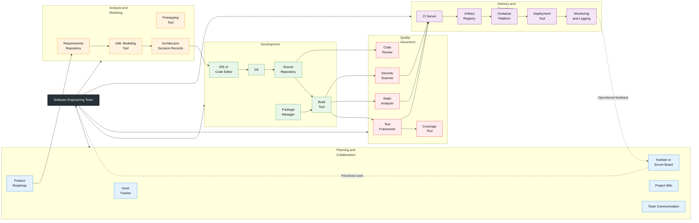

<div align="center">

# **`Awesome`** Software Engineering [](https://awesome.re)
</div>

[]() 
[]()

<p align="center">
    <a href="https://github.com/cybersecurity-dev/"></a>
    &nbsp;
    <a href="https://www.youtube.com/@CyberThreatDefence"></a>
    &nbsp;
    <a href="https://cyberthreatdefence.com/my_awesome_lists"></a>
    
</p>


## 📖 Contents
- [Design Guidelines for Object-Oriented Software Development](#design-guidelines-for-object-oriented-software-development)
    - [SOLID](#solid) 
- [Function calls](#function-calls)
- [Calling Convention](#calling-convention)
- [My Other Awesome Lists](#my-other-awesome-lists)
- [Contributing](#contributing)
- [Contributors](#contributors)


## Design Guidelines for Object-Oriented Software Development

### SOLID

- S — `Single Responsibility Principle (SRP)`
- O — `Open/Closed Principle (OCP)`
- L — `Liskov Substitution Principle (LSP)`
- I — `Interface Segregation Principle (ISP)`
- D — `Dependency Inversion Principle (DIP)`

## Function calls

### 1. Pass by Value (C \& C++)
```
A copy of the variable is passed to the function. The original variable is NOT changed.
```
```c
void foo(int x) {
    x = 100;   // modifies only the copy
}
```
### 2. Pass by Pointer (C \& C++)
```
Instead of passing a value, you pass the address of a variable. The function can modify the original variable using pointers.
```
```c
void bar(int *x) {
    *x = 100;  // modifies original value
}
```

### 3. Pass by Reference (C++ only)
```
The function receives a reference (alias) to the original variable. No need to use pointers (*, & inside function body). Changes affect the original variable directly.
```
```c
void bar(int &x) {
    x = 100;   // directly modifies original
}
```
## Calling Convention

### 1. `__cdecl`
__cdecl stands for `"C declaration"` convention.

Key characteristics:
- ✅ Arguments are passed on the stack (right → left)
- ✅ Caller cleans up the stack after the function call
- ✅ Supports variable number of arguments (e.g., printf)
- ✅ Default calling convention in many C/C++ compilers (like MSVC for x86)

```c
int __cdecl add(int a, int b) {
    return a + b;
}
```

```
Simplified Call Flow:
    Push b
    Push a
    Call add function
    Function returns
    Caller removes arguments from the stack
```

### 2. `__stdcall`
Key characteristics:
- ✅ Arguments passed right → left (same as **__cdecl**)
- ❌ Callee cleans up the stack
- ✅ Used in Windows API

### 3. `__fastcall`

Key characteristics:
- ✅ First arguments passed in registers (faster)
- ✅ Remaining arguments go on the stack
- ✅ Can improve performance

### 4. `__thiscall`
Used for C++ class member functions

Key characteristics:
- ✅ this pointer passed in a register (usually ECX)
- ✅ Other arguments on stack

### 5. `__vectorcall` (modern)

Key characteristics:
- ✅ Optimized for SIMD/vector operations
- ✅ Passes arguments in vector registers

| Convention     | Stack Cleanup | Argument Passing        | Typical Use               |
|----------------|--------------|------------------------|--------------------------|
| 1. `__cdecl`      | Caller       | Stack (right to left)  | Default C functions      |
| 2. `__stdcall`    | Callee       | Stack (right to left)  | Windows API              |
| 3. `__fastcall`   | Callee       | Registers + stack      | Performance optimization |
| 4. `__thiscall`   | Callee       | `this` in register + stack | C++ member functions |
| 5. `__vectorcall` | Callee       | Vector registers + stack | SIMD / vector operations |

* `Caller` = the function that calls another function
* `Callee` = the function that is being called


##

### My Other Awesome Lists
You can access the my other awesome lists [here](https://cyberthreatdefence.com/my_awesome_lists)

### Contributing
[Contributions of any kind welcome, just follow the guidelines](contributing.md)!

### Contributors
[Thanks goes to these contributors](https://github.com/cybersecurity-dev/awesome-software-engineering/graphs/contributors)!

### License
[](http://creativecommons.org/publicdomain/zero/1.0)

[🔼 Back to top](#awesome-software-engineering-)
